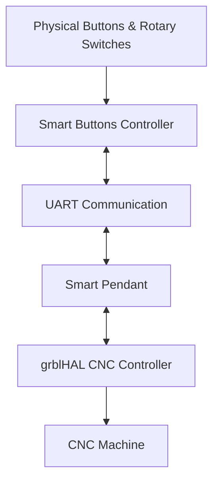

# OpenCNC-Pendant

### CNC Pendant Firmware Development

OpenCNC-Pendant is a C++ project focused on developing software for a CNC pendant that works with a grblHAL CNC controller.

The system consists of two main parts: a Smart Pendant and a separate Smart Buttons Controller. The Smart Buttons Controller reads physical buttons and rotary switches and sends their states to the Smart Pendant, which handles the input processing and communication with the CNC controller.

We are starting with a PC-based simulator so that we can develop and test the main logic before moving to actual hardware.

## Project Architecture



## Hardware Configuration

The current software configuration includes:

| Component | Quantity |
|---|---:|
| Push buttons | 13 |
| ON/OFF switches | 2 |
| Selector switches | 5 |
| MPG encoder signals | 2 |
| LED outputs | 10 |
| UART baud rate | 115200 |

*These values are based on the current configuration and will be verified during hardware integration.*

## Project Structure

```text
OpenCNC-Pendant/
│
├── include/
│   ├── config.h
│   ├── input_interface.h
│   └── pendant.h
│
├── src/
│   ├── main.cpp
│   └── pendant.cpp
│
├── .gitignore
└── README.md
```

| File | Description |
|---|---|
| `config.h` | Stores hardware and communication settings. |
| `input_interface.h` | Defines the different pendant input states. |
| `pendant.h` | Contains the Pendant class declaration. |
| `pendant.cpp` | Handles the current input-processing logic. |
| `main.cpp` | Runs the terminal-based simulator. |

## Current Progress

So far, we have created the initial C++ project structure and a basic terminal simulator.

The simulator allows us to select different buttons, switches, MPG signals and selector positions through the keyboard. These inputs are passed to the `Pendant` class, where their current states are processed and displayed.

This gives us a starting point for developing and testing the application logic without connecting physical hardware.

The actual hardware input handling, UART communication and grblHAL integration are still to be developed.

## Development Roadmap

### Phase 1 – Project Setup
- [x] Create the initial C++ project structure.
- [x] Define hardware configuration.
- [x] Create the pendant input interface.
- [x] Implement the initial Pendant class.
- [x] Build a basic terminal simulator.

### Phase 2 – Input and Application Logic
- [ ] Implement complete button handling.
- [ ] Add button press and release detection.
- [ ] Implement button debouncing.
- [ ] Decode rotary selector positions.
- [ ] Implement operating mode and axis selection.
- [ ] Implement feed and spindle override logic.
- [ ] Decode MPG encoder signals.
- [ ] Test the application logic on the PC.

### Phase 3 – Communication
- [ ] Configure UART communication.
- [ ] Define the data format between both controllers.
- [ ] Implement data transmission and reception.
- [ ] Add basic error handling.
- [ ] Test communication between the Smart Buttons Controller and Smart Pendant.

### Phase 4 – Hardware Integration
- [ ] Configure the target microcontroller.
- [ ] Configure GPIO and I/O expansion.
- [ ] Connect physical buttons and switches.
- [ ] Integrate rotary selectors and MPG.
- [ ] Implement LED control.
- [ ] Verify hardware inputs and outputs.

### Phase 5 – grblHAL Integration
- [ ] Understand the required grblHAL communication interface.
- [ ] Implement command transmission.
- [ ] Read and process controller status.
- [ ] Implement jogging and machine-control functions.
- [ ] Test communication with the CNC controller.

### Phase 6 – Build and Testing
- [ ] Configure the embedded development environment.
- [ ] Compile the complete firmware.
- [ ] Flash firmware onto the hardware.
- [ ] Test individual controls.
- [ ] Test communication between all components.
- [ ] Validate the complete pendant functionality.

## Development Tools

**Currently using:**
- C++17
- GCC / MSYS2
- Visual Studio Code
- GDB

**Planned for embedded development:**
- STM32CubeIDE
- ARM GNU Toolchain
- STM32CubeProgrammer

## Build and Run

Clone the repository:

```bash
git clone https://github.com/PiyushKumar-Dev/OpenCNC-Pendant.git
cd OpenCNC-Pendant
```

Compile the simulator:

```bash
g++ -std=c++17 -Wall -Wextra -Iinclude src/main.cpp src/pendant.cpp -o cnc_pendant_sim
```

Run on Windows:

```powershell
.\cnc_pendant_sim.exe
```

Run on Linux:

```bash
./cnc_pendant_sim
```

## Development Approach

The idea is to build this project step by step. We will first complete and test the application logic on a PC, then work on communication between the controllers, and finally integrate everything with the actual hardware and grblHAL.

Each part will be tested before moving to the next stage.

**Repository:** [OpenCNC-Pendant](https://github.com/PiyushKumar-Dev/OpenCNC-Pendant)